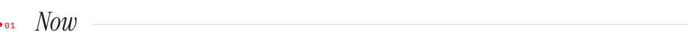
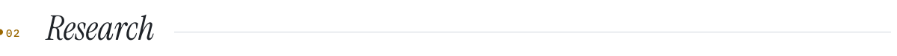
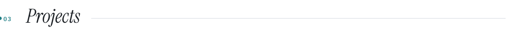
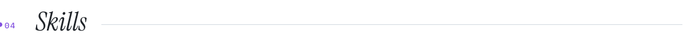
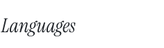

<picture>
  <source media="(prefers-color-scheme: dark)" srcset="assets/masthead-dark.svg">
  
</picture>

I'm a Computer Science undergraduate at Thapar Institute of Engineering & Technology. I work on models that read retinal images, ECG and text, and on explaining what those models have learned.

<picture><source media="(prefers-color-scheme: dark)" srcset="assets/ui/head-now-dark.svg"></picture>

- Research Intern (GenAI), Samsung R&D Institute, India
- Research Intern, Thapar Institute

<picture><source media="(prefers-color-scheme: dark)" srcset="assets/ui/head-research-dark.svg"></picture>

<picture>
  <source media="(prefers-color-scheme: dark)" srcset="assets/interests-dark.svg">
  
</picture>

<picture>
  <source media="(prefers-color-scheme: dark)" srcset="assets/threads-dark.svg">
  
</picture>

**CardioVision.** Research Intern at Thapar Institute.

**NLP and LLM evaluation.** Biomedical named entity recognition and how it holds up as entities drift over time, across encoder and generative model families. In legal NLP, statistically tested comparisons of fine-tuned encoders against zero- and few-shot open-weight LLMs.

**Inverse reinforcement learning.** Recovering the reward functions that explain an agent's observed behaviour, so that learned policies become interpretable.

<picture><source media="(prefers-color-scheme: dark)" srcset="assets/ui/head-projects-dark.svg"></picture>

**CyberSOC-Agent**: insider threat detection and investigation. An ensemble of scenario rules, XGBoost with SHAP, Isolation Forest and an autoencoder scores risk; a ReAct LLM agent then investigates each alert and verifies every cited item against tool output. Third place, Techkriti '26, IIT Kanpur.

**[SunoSakhi](https://github.com/Aayush-Bindal/SunoSakhi)**: a voice-based health assistant that lets people without a smartphone ask health questions by phone in 12 regional languages. I built the FastAPI voice pipeline. Team project, first place, Society Hackathon.

**Forensic**: acquisition, recovery and analysis of DVR/NVR surveillance evidence across vendors, with LLM-guided discovery of proprietary formats and YOLO-based event indexing. Team project, built with Rust, Python and Tauri.

**[few-shot-anomaly-views](https://github.com/iakshatkaushik/few-shot-anomaly-views)**: few-shot visual anomaly detection, comparing augmented views as nearest-neighbour memory against contrastive training on frozen DINOv2/DINOv3 features.

<picture><source media="(prefers-color-scheme: dark)" srcset="assets/ui/head-skills-dark.svg"></picture>

  <picture><source media="(prefers-color-scheme: dark)" srcset="assets/ui/label-languages-dark.svg"></picture>
  
  
  
  
  
  

  <picture><source media="(prefers-color-scheme: dark)" srcset="assets/ui/label-ml-and-data-dark.svg"></picture>
  
  
  
  
  
  
  

  <picture><source media="(prefers-color-scheme: dark)" srcset="assets/ui/label-web-and-backend-dark.svg"></picture>
  
  
  
  
  
  
  
  
  

  <picture><source media="(prefers-color-scheme: dark)" srcset="assets/ui/label-tools-and-infra-dark.svg"></picture>
  
  
  
  
  
  
  

**Also** XGBoost, SHAP, Sentence Transformers, imbalanced-learn, ChromaDB, YOLO

**Methods** experimental design, benchmark and ablation evaluation, statistical hypothesis testing, zero- and few-shot LLM evaluation, model interpretability (SHAP, sparse autoencoders)

<picture><source media="(prefers-color-scheme: dark)" srcset="assets/ui/head-elsewhere-dark.svg"></picture>

  
  

<picture><source media="(prefers-color-scheme: dark)" srcset="assets/ui/pulse-dark.svg"></picture>
