<picture>
  <source media="(prefers-color-scheme: dark)" srcset="assets/hero-dark.svg">
  
</picture>

I'm a Computer Science undergraduate at Thapar Institute of Engineering & Technology. I work on models that read retinal images, ECG and text, and on explaining what those models have learned.

## Now

- Research Intern (GenAI), Samsung R&D Institute, India
- Research Intern, CardioVision, Thapar Institute
- Founder, Epoch, an early-stage AI healthcare research initiative

## Research

**Interests.** Multimodal medical AI (retinal fundus imaging, ECG), interpretable deep learning and explainable AI, biomedical and legal NLP, evaluation and temporal robustness of large language models, LLM agents.

**CardioVision.** A funded project at Thapar Institute (Dassault Systèmes Foundation, with PGIMER as clinical partner) on non-invasive cardiovascular screening. It fuses ECG and retinal fundus biomarkers such as HRV, QT interval, vessel tortuosity and arteriovenous ratio, and benchmarks multimodal models against single-modality ones. I design and run the deep learning experiments in PyTorch.

## Projects

**CyberSOC-Agent**: insider threat detection and investigation. An ensemble of scenario rules, XGBoost with SHAP, Isolation Forest and an autoencoder scores risk; a ReAct LLM agent then investigates each alert and verifies every cited item against tool output. Third place, Techkriti '26, IIT Kanpur.

**[SunoSakhi](https://github.com/Aayush-Bindal/SunoSakhi)**: a voice-based health assistant that lets people without a smartphone ask health questions by phone in 12 regional languages. I built the FastAPI voice pipeline. Team project, first place, Society Hackathon.

**Forensic**: acquisition, recovery and analysis of DVR/NVR surveillance evidence across vendors, with LLM-guided discovery of proprietary formats and YOLO-based event indexing. Team project, built with Rust, Python and Tauri.

**[few-shot-anomaly-views](https://github.com/iakshatkaushik/few-shot-anomaly-views)**: few-shot visual anomaly detection, comparing augmented views as nearest-neighbour memory against contrastive training on frozen DINOv2/DINOv3 features.

## Tools

Python, C, C++, JavaScript, SQL · PyTorch, scikit-learn, XGBoost, SHAP, OpenCV · FastAPI, PostgreSQL, ChromaDB, AWS EC2, Linux

## Elsewhere

[LinkedIn](https://www.linkedin.com/in/iakshatkaushik) · [ORCID](https://orcid.org/0009-0009-9848-3883)
