  

I'm a Computer Science undergraduate at **Thapar Institute of Engineering & Technology**, doing research on models that look at eyes, heartbeats and text, and on being able to explain what those models have learned. Most of my work sits where **medical AI**, **interpretability** and **language model evaluation** meet.

### Right now

- 🔬 **Research Intern (GenAI)** at Samsung R&D Institute, India
- 🫀 **Research Intern, CardioVision** at Thapar Institute, working on non-invasive cardiovascular screening from retinal fundus images and ECG
- 🧪 **Founder, Epoch**, an early-stage AI healthcare research initiative
- 🎓 **B.E. Computer Science and Engineering**, Thapar Institute

  

### CardioVision

A funded research project (Dassault Systèmes Foundation, with PGIMER as clinical partner) that fuses ECG and retinal fundus biomarkers for interpretable, non-invasive heart health screening in resource-constrained settings. My part is the deep learning experiments in PyTorch: image restoration preprocessing, transformer-based feature extraction, tabular deep transformers on interpretable vascular biomarkers, and multimodal ECG–retina fusion, evaluated against single-modality baselines.

  

### Things I've built

| Project | What it is | Stack |
| :-- | :-- | :-- |
| **CyberSOC-Agent** 🥉 Third Place, Techkriti '26, IIT Kanpur | AI-powered insider threat detection and investigation. An ensemble of scenario rules, XGBoost + SHAP, Isolation Forest and an autoencoder produces risk scores; a ReAct LLM agent then investigates alerts and verifies every cited item against tool output. | `Python` `XGBoost` `SHAP` `PyTorch` `ChromaDB` `FastAPI` `React` |
| **[SunoSakhi](https://github.com/Aayush-Bindal/SunoSakhi)** 🥇 First Place, Society Hackathon · team project | Voice-based multilingual health assistant. People without a smartphone can ask health questions by phone in 12 regional languages, with multi-turn follow-ups. I built the FastAPI voice pipeline. [Website](https://suno-sakhi.vercel.app) | `Python` `FastAPI` `Exotel` `Google Cloud Speech` `Mistral 7B` |
| **Forensic** team project | Multi-vendor surveillance evidence analysis: forensically sound acquisition, deleted-footage recovery and audit-ready reporting for DVR/NVR systems, with LLM-guided discovery of proprietary vendor formats and YOLO-based event indexing. | `Rust` `Python` `React` `Tauri` `YOLO` |
| **[few-shot-anomaly-views](https://github.com/iakshatkaushik/few-shot-anomaly-views)** | Few-shot visual anomaly detection: augmented views as nearest-neighbour memory vs. contrastive training, on frozen DINOv2/DINOv3 features. | `Python` |

### Toolbox

**Research** &nbsp; experimental design · benchmark and ablation evaluation · statistical hypothesis testing · zero-shot and few-shot LLM evaluation · model interpretability (SHAP, sparse autoencoders)

**ML / DL** &nbsp; `PyTorch` `scikit-learn` `XGBoost` `SHAP` `NumPy` `pandas` `OpenCV` `Sentence Transformers` `imbalanced-learn`

**Languages** &nbsp; `Python` `C` `C++` `JavaScript` `SQL` `Bash`

**Infra** &nbsp; `Linux` `Git` `FastAPI` `Flask` `PostgreSQL` `MySQL` `SQLite` `ChromaDB` `AWS EC2` `Nginx`

  

  <a href="https://www.linkedin.com/in/iakshatkaushik">LinkedIn</a> &nbsp;·&nbsp;
  <a href="https://orcid.org/0009-0009-9848-3883">ORCID</a>

