<picture>
  <source media="(prefers-color-scheme: dark)" srcset="assets/hero-dark.svg">
  
</picture>

I'm a Computer Science undergraduate at Thapar Institute of Engineering & Technology. I work on models that read retinal images, ECG and text, and on explaining what those models have learned.

## Now

- Research Intern (GenAI), Samsung R&D Institute, India
- Research Intern, CardioVision, Thapar Institute
- Research Intern, Inverse Reinforcement Learning, Thapar Institute

## Research

<picture>
  <source media="(prefers-color-scheme: dark)" srcset="assets/interests-dark.svg">
  
</picture>

<picture>
  <source media="(prefers-color-scheme: dark)" srcset="assets/threads-dark.svg">
  
</picture>

**CardioVision.** Research Intern at Thapar Institute.

**NLP and LLM evaluation.** Biomedical named entity recognition and how it holds up as entities drift over time, across encoder and generative model families. In legal NLP, statistically tested comparisons of fine-tuned encoders against zero- and few-shot open-weight LLMs.

**Inverse reinforcement learning.** Recovering the reward functions that explain an agent's observed behaviour, so that learned policies become interpretable.

## Projects

**CyberSOC-Agent**: insider threat detection and investigation. An ensemble of scenario rules, XGBoost with SHAP, Isolation Forest and an autoencoder scores risk; a ReAct LLM agent then investigates each alert and verifies every cited item against tool output. Third place, Techkriti '26, IIT Kanpur.

**[SunoSakhi](https://github.com/Aayush-Bindal/SunoSakhi)**: a voice-based health assistant that lets people without a smartphone ask health questions by phone in 12 regional languages. I built the FastAPI voice pipeline. Team project, first place, Society Hackathon.

**Forensic**: acquisition, recovery and analysis of DVR/NVR surveillance evidence across vendors, with LLM-guided discovery of proprietary formats and YOLO-based event indexing. Team project, built with Rust, Python and Tauri.

**[few-shot-anomaly-views](https://github.com/iakshatkaushik/few-shot-anomaly-views)**: few-shot visual anomaly detection, comparing augmented views as nearest-neighbour memory against contrastive training on frozen DINOv2/DINOv3 features.

## Skills

<picture>
  <source media="(prefers-color-scheme: dark)" srcset="assets/skills-dark.svg">
  
</picture>

## Elsewhere

[LinkedIn](https://www.linkedin.com/in/iakshatkaushik) · [ORCID](https://orcid.org/0009-0009-9848-3883)
